# Portfólio de Templates de Email Marketing

Bem-vindo ao meu portfólio! Aqui apresento o resultado visual dos templates de email marketing responsivos e compatíveis com múltiplos clientes de email (Outlook, Gmail, Apple Mail, Yahoo).

---

## 📧 Template 1: Template de Email Marketing: Onboarding & Boas-Vindas (Claro Multi)

Este projeto consiste em um template HTML de email marketing transacional/relacional voltado para o fluxo de Onboarding (Boas-vindas) e Retenção de Clientes do plano Claro Multi.

### Visualização:

<table>
  <thead>
    <tr>
      <th align="center">Versão Desktop</th>
      <th align="center">Versão Mobile</th>
    </tr>
  </thead>
  <tbody>
    <tr>
      <td align="center" valign="top">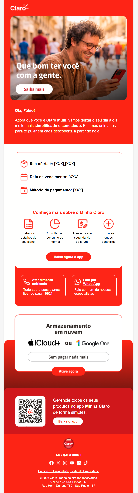</td>
      <td align="center" valign="top"></td>
    </tr>
  </tbody>
</table>

---

## 📧 Template 2: Template de Email Marketing: Campanha Promocional & E-commerce (LG DualCool)

Este projeto consiste em um template HTML de email marketing promocional e comercial de alta conversão focado na vitrine de produtos e ofertas sazonais da LG (linha de ar-condicionado LG DualCool AI com brindes inclusos).

### Visualização:

<table>
  <thead>
    <tr>
      <th align="center">Versão Desktop</th>
      <th align="center">Versão Mobile</th>
    </tr>
  </thead>
  <tbody>
    <tr>
      <td align="center" valign="top">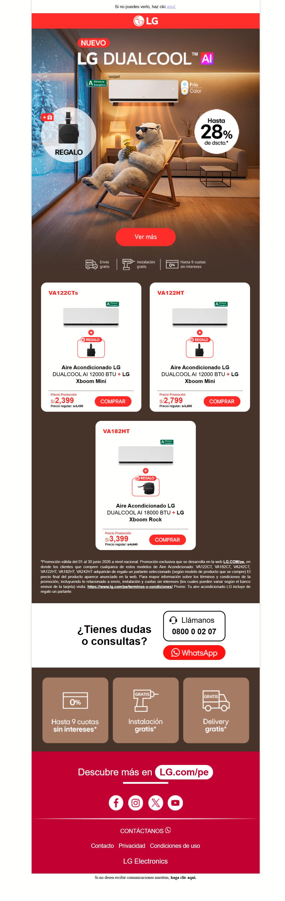</td>
      <td align="center" valign="top">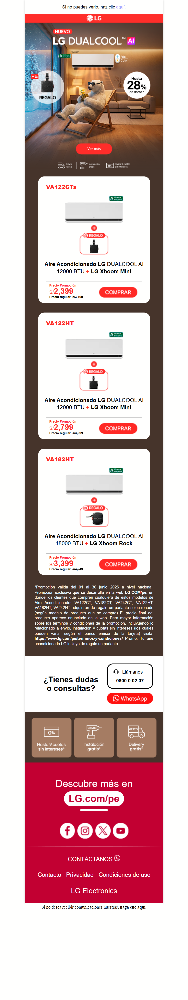</td>
    </tr>
  </tbody>
</table>

---

## 📧 Template 3: Template de Email Marketing: Campanha Promocional Relâmpago / Fim de Semana (LG - Fin de Semana de Ahorros)

Este projeto consiste num template HTML de email marketing promocional e comercial de alta conversão, focado em campanhas relâmpago de fim de semana (ex: "Un fin de semana de ahorros / 72 horas") para a marca LG. O seu foco principal é acelerar a decisão de compra através de descontos expressivos por tempo limitado e facilidades de financiamento.

### Visualização:

<table>
  <thead>
    <tr>
      <th align="center">Versão Desktop</th>
      <th align="center">Versão Mobile</th>
    </tr>
  </thead>
  <tbody>
    <tr>
      <td align="center" valign="top">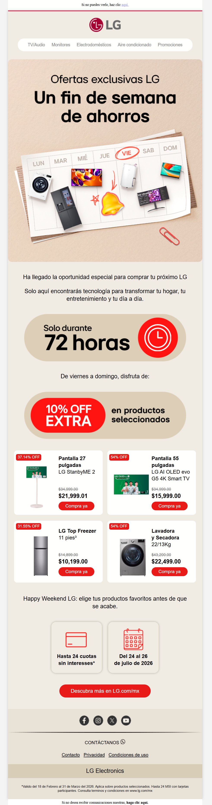</td>
      <td align="center" valign="top">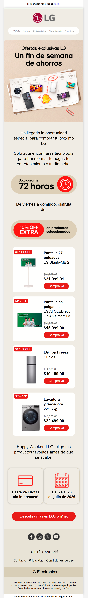</td>
    </tr>
  </tbody>
</table>

---

## 📧 Template 4: Template de Email Marketing: Educacional & Informativo (Mercado Livre - Afiliados e Criadores)

Este projeto consiste num template HTML de email marketing educacional e informativo desenvolvido para o **Programa de Afiliados e Criadores do Mercado Livre. O seu foco principal é a comunicação institucional com criadores e parceiros, detalhando regras de monetização, comissionamento e políticas do programa.

### Visualização:

<table>
  <thead>
    <tr>
      <th align="center">Versão Desktop</th>
      <th align="center">Versão Mobile</th>
    </tr>
  </thead>
  <tbody>
    <tr>
      <td align="center" valign="top">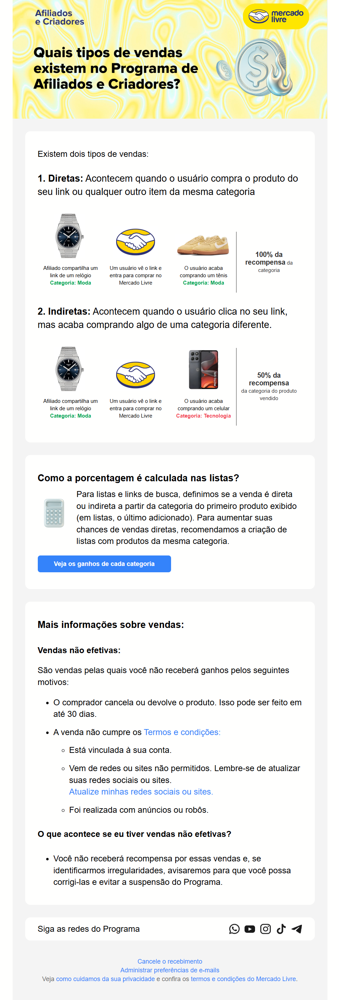</td>
      <td align="center" valign="top">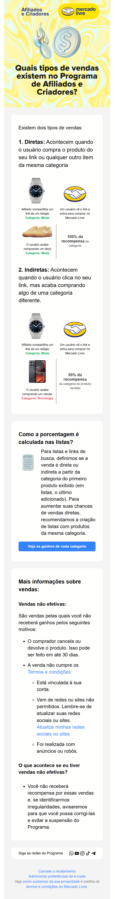</td>
    </tr>
  </tbody>
</table>

---

## 📧 Template 5: Template de Email Marketing: Ofertas do Dia & E-commerce (Mercado Livre)

Este projeto consiste num template HTML de email marketing promocional de alta conversão estruturado para campanhas de **Ofertas do Dia** do Mercado Livre. O foco é a exibição de ofertas relâmpago personalizadas e vitrines de produtos baseadas no comportamento de navegação do usuário.

### Visualização:

<table>
  <thead>
    <tr>
      <th align="center">Versão Desktop</th>
      <th align="center">Versão Mobile</th>
    </tr>
  </thead>
  <tbody>
    <tr>
      <td align="center" valign="top">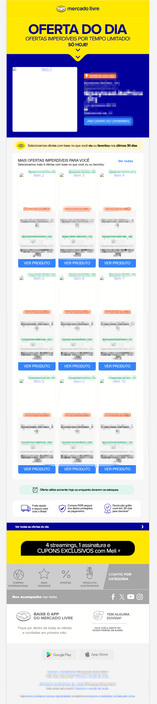</td>
      <td align="center" valign="top"></td>
    </tr>
  </tbody>
</table>

---

## 📧 Template 6: Template de Email Marketing: Recuperação de Carrinho & Retargeting (Mercado Livre)

Este projeto consiste num template HTML de email marketing transacional de recuperação de carrinho abandonado e retargeting estruturado para a plataforma do Mercado Livre. O foco principal é reengajar utilizadores que deixaram produtos no carrinho ou navegaram recentemente, criando urgência para fechar a compra.

### Visualização:

<table>
  <thead>
    <tr>
      <th align="center">Versão Desktop</th>
      <th align="center">Versão Mobile</th>
    </tr>
  </thead>
  <tbody>
    <tr>
      <td align="center" valign="top">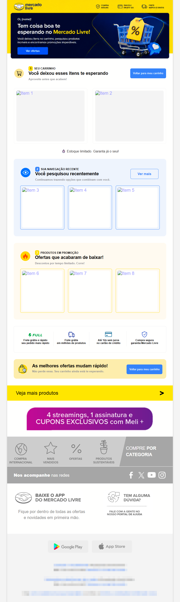</td>
      <td align="center" valign="top">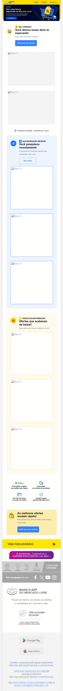</td>
    </tr>
  </tbody>
</table>

---

## 📧 Template 7: Template de Email Marketing: Evento Corporativo & Multilíngue (Forum Latam)

Este projeto consiste num template HTML de email marketing transacional e institucional para convites de eventos corporativos de alto nível (Forum Latam). O template destaca-se pela sua capacidade multilíngue (disponível em inglês, espanhol e português) e estruturação orientada para a inscrição de executivos.

### Visualização:

<table>
  <thead>
    <tr>
      <th align="center">Versão Desktop</th>
      <th align="center">Versão Mobile</th>
    </tr>
  </thead>
  <tbody>
    <tr>
      <td align="center" valign="top">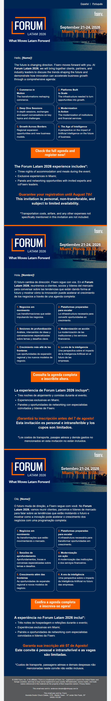</td>
      <td align="center" valign="top"></td>
    </tr>
  </tbody>
</table>

---

## 📧 Template 8: Template de Email Marketing: Onboarding & Boas-Vindas Educacional (Senac RJ)

Este projeto consiste num template HTML de email marketing transacional e relacional focado no acolhimento de novos alunos (Onboarding Educacional) para o Senac RJ. O foco principal é a comunicação de boas-vindas institucional para a transição de alunos para uma nova unidade de ensino.

### Visualização:

<table>
  <thead>
    <tr>
      <th align="center">Versão Desktop</th>
    </tr>
  </thead>
  <tbody>
    <tr>
      <td align="center" valign="top">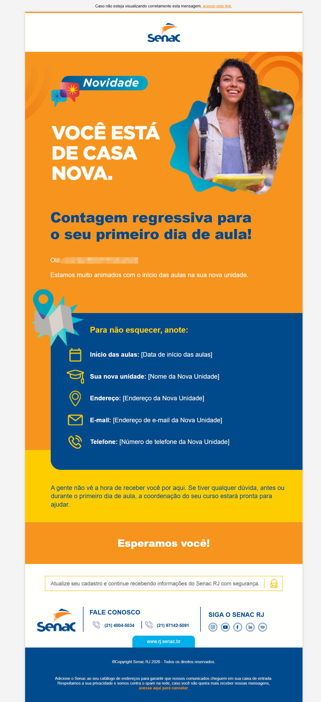</td>
    </tr>
  </tbody>
</table>

---

## 📧 Template 9: Template de Email Marketing: Processo Seletivo & Convocação (Senac RJ - Gastronomia)

Este projeto consiste num template HTML de email marketing transacional e de recrutamento voltado para a convocação de candidatos para entrevistas presenciais no Programa de Formação e Prática Profissional em Gastronomia do Senac RJ. O foco principal é a comunicação clara de instruções para etapas de processos seletivos educacionais.

### Visualização:

<table>
  <thead>
    <tr>
      <th align="center">Versão Desktop</th>
    </tr>
  </thead>
  <tbody>
    <tr>
      <td align="center" valign="top">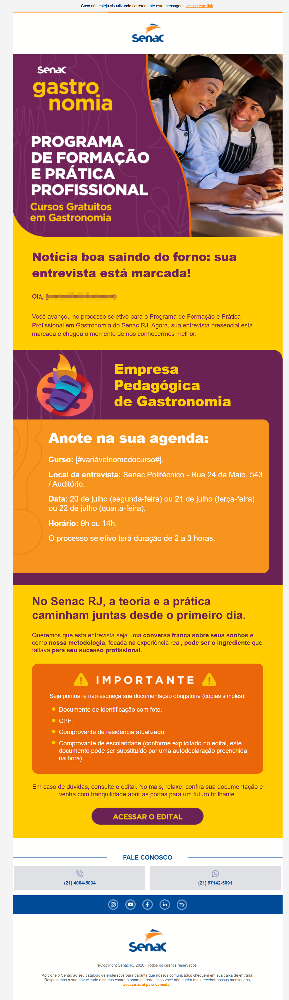</td>
    </tr>
  </tbody>
</table>

---

## 📧 Template 10: Template de Email Marketing: Aprovação & Convocação para Matrícula (Senac RJ - Gastronomia)

Este projeto consiste num template HTML de email marketing transacional voltado para a comunicação de aprovação em processo seletivo e convocação oficial para o período de matrícula no Programa de Formação e Prática Profissional em Gastronomia do Senac RJ. O foco principal é a retenção do aluno aprovado e a orientação clara sobre os prazos de inscrição.

### Visualização:

<table>
  <thead>
    <tr>
      <th align="center">Versão Desktop</th>
    </tr>
  </thead>
  <tbody>
    <tr>
      <td align="center" valign="top">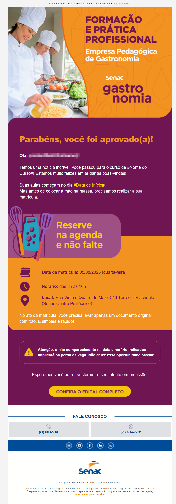</td>
    </tr>
  </tbody>
</table>

---

## 📧 Template 11: Template de Email Marketing: Newsletter B2B & Editorial (Claro Empresas - Próximo Nível)

Este projeto consiste num template HTML de email marketing editorial e informativo no formato de newsletter corporativa B2B, desenvolvido para a marca Claro empresas (editorial "Próximo Nível"). O seu foco principal é a distribuição de conteúdos sobre tecnologia, soberania digital, inteligência artificial e inovação empresarial para executivos e decisores de mercado.

### Visualização:

<table>
  <thead>
    <tr>
      <th align="center">Versão Desktop</th>
    </tr>
  </thead>
  <tbody>
    <tr>
      <td align="center" valign="top">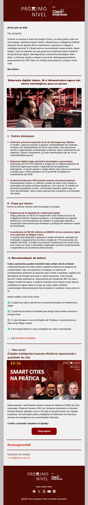</td>
    </tr>
  </tbody>
</table>

---

## 📧 Template 12: Template de Email Marketing: Formulário Interativo / Captura de Leads (Granado - Desde 1870)

Este projeto consiste num template HTML de email marketing transacional e interativo focado na captura de dados e cadastros de novos clientes (Lead Generation), desenvolvido para a marca tradicional de perfumaria e cosméticos Granado. O seu foco principal é incentivar o registo do utilizador em troca de um benefício comercial exclusivo.

### Visualização:

<table>
  <thead>
    <tr>
      <th align="center">Versão Desktop</th>
    </tr>
  </thead>
  <tbody>
    <tr>
      <td align="center" valign="top">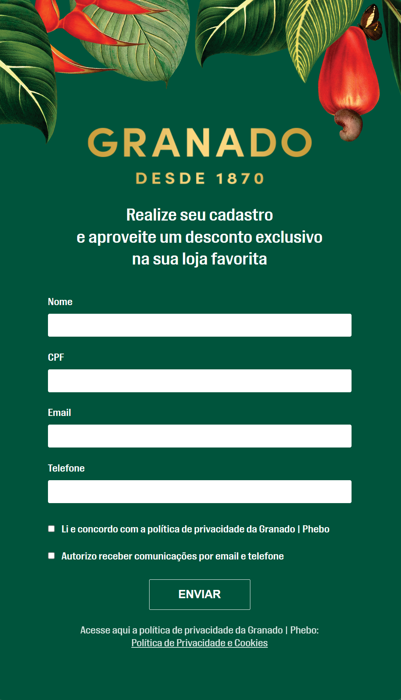</td>
    </tr>
  </tbody>
</table>

---

## 📧 Template 13: Template de Email Marketing: Campanha Promocional & Vitrine de E-commerce (LG DualCool - Versão 2)

Este projeto consiste num template HTML de email marketing promocional e comercial de alta conversão, focado na divulgação de vitrines de produtos, ofertas sazonais e campanhas de aparelhos de ar-condicionado da marca LG (linha LG DualCool AI com brindes associados).

### Visualização:

<table>
  <thead>
    <tr>
      <th align="center">Versão Mobile</th>
    </tr>
  </thead>
  <tbody>
    <tr>
      <td align="center" valign="top">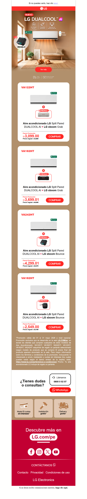</td>
    </tr>
  </tbody>
</table>

---

## 🛠️ Competências Técnicas Aplicadas nestes Projetos
- HTML5 Estruturado com Tabelas (`<table>`) para compatibilidade avançada de e-mails[cite: 1].
- CSS Inline / CSS Responsivo com Media Queries[cite: 1].
- Suporte e renderização testados em Outlook, Gmail e Apple Mail[cite: 1].
